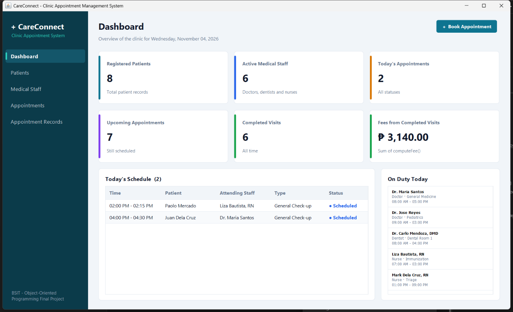
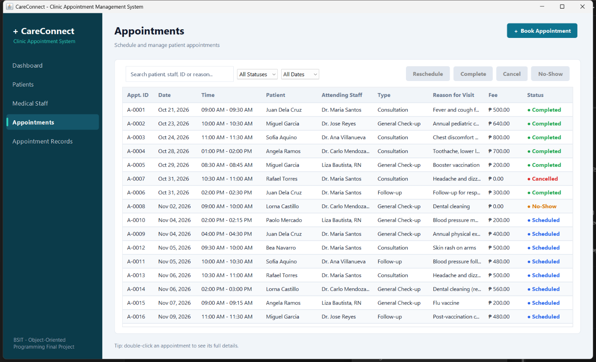
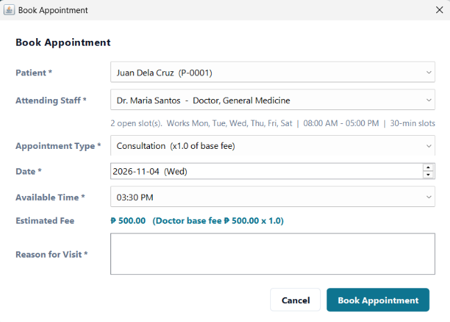
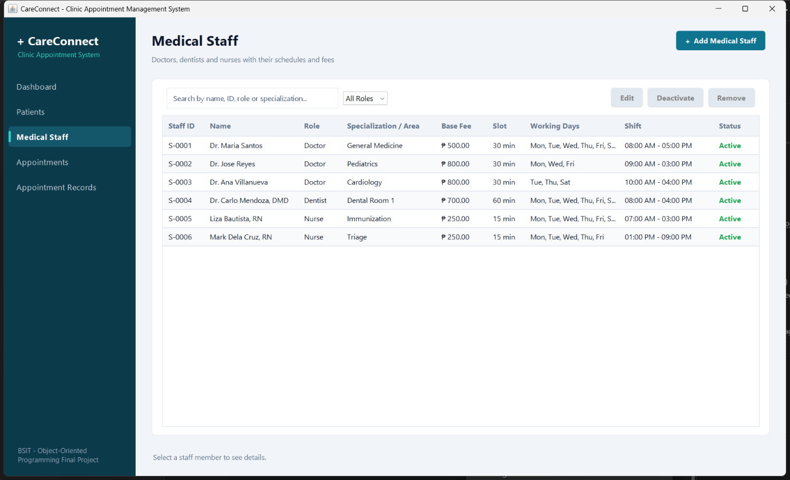
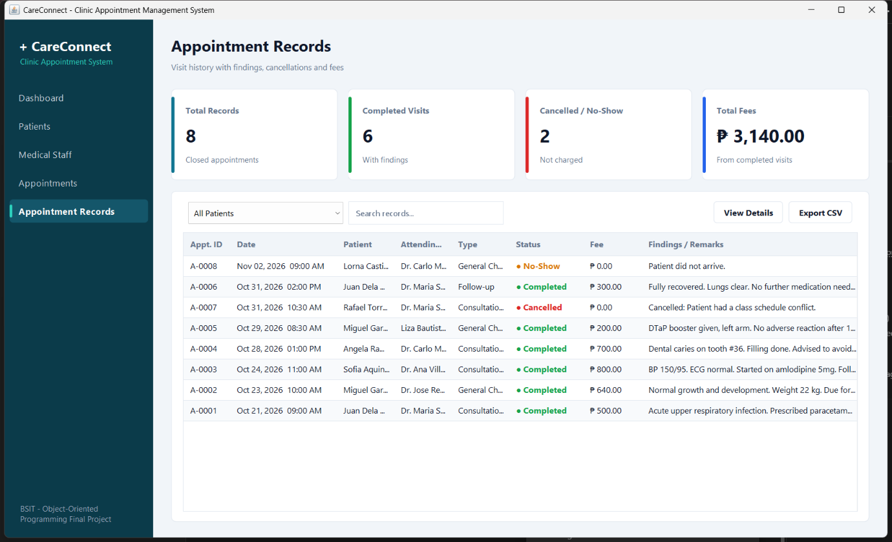

# CareConnect: Clinic Appointment Management System

A Java desktop application for managing **patient registration, appointment scheduling, medical personnel and appointment records** in a clinic. It was built as the final project for **Object-Oriented Programming (Scenario 3)** and demonstrates the four pillars of OOP: **Encapsulation, Inheritance, Polymorphism and Abstraction**.



## Features

- **Dashboard**: patient and staff counts, today's schedule, upcoming and completed visits, fees collected, staff on duty
- **Patients**: register, edit, search and delete, with validation (PH mobile numbers, birth date and so on)
- **Medical Staff**: Doctors, Dentists and Nurses with specialization, PRC license, working days and shift hours; activate or deactivate
- **Appointments**: book only *available* slots, with no double booking of staff or patient; reschedule, complete with findings, cancel with reason, or mark no-show
- **Automatic fees**: based on staff type (Doctor / Dentist / Nurse) × appointment type (Consultation, Follow-up, Check-up, Emergency)
- **Appointment Records**: visit history per patient, summary totals, CSV export
- **Auto-save**: all data is saved to `data/clinic-data.ser`, and sample data is loaded on the first run

| Appointments | Book Appointment |
|---|---|
|  |  |
| **Medical Staff** | **Appointment Records** |
|  |  |

## How to Run

**Requirement:** Java JDK 17 or newer ([download](https://www.oracle.com/java/technologies/downloads/)).

**Windows:** double-click `run.bat`. The first time, it compiles the code automatically.

**Command line (any OS):**

```bash
javac --release 17 -encoding UTF-8 -d out $(find src -name "*.java")
java -cp out clinic.Main
```

**IDE (NetBeans / IntelliJ / VS Code / Eclipse):** open the folder as a project, mark `src` as the source root, and run `clinic.Main`.

## Project Structure

```
src/clinic/
├── Main.java                 Entry point
├── model/                    Domain classes (the OOP core)
│   ├── Person.java           abstract: base of every person
│   ├── Patient.java          extends Person
│   ├── MedicalStaff.java     abstract: extends Person
│   ├── Doctor.java           extends MedicalStaff
│   ├── Dentist.java          extends MedicalStaff
│   ├── Nurse.java            extends MedicalStaff
│   ├── Appointment.java      links Patient and MedicalStaff
│   ├── AppointmentStatus.java / AppointmentType.java   enums
│   ├── Identifiable.java / Searchable.java / Billable.java   interfaces
│   └── StaffFactory.java     creates the right MedicalStaff subclass
├── repository/               Repository<T> interface + InMemoryRepository<T>
├── data/                     ClinicDatabase, FileStorage (save/load), SampleDataLoader
├── service/                  ClinicService (business rules), ValidationException
└── ui/                       Swing user interface
    ├── MainFrame.java, UITheme.java
    ├── panels/               BasePanel (abstract) + Dashboard, Patient, Staff, Appointment, Records
    ├── dialogs/              FormDialog (abstract) + Patient, Staff, Appointment dialogs
    ├── table/                EntityTableModel<T> (abstract) + table models, cell renderer
    └── components/           RoundedButton, RoundedPanel, StatCard, NavButton, HintTextField
docs/
├── CareConnect-Documentation.docx   Project documentation (Word) for submission
├── DOCUMENTATION.md          Overview, objectives, UML class diagrams, OOP explanation
├── class-diagram.html        Open in a browser to view or print the class diagrams
├── diagrams/                 UML class diagrams as PNG images (for slides)
└── screenshots/
```

## OOP Pillars at a Glance

| Pillar | Where to look |
|---|---|
| **Encapsulation** | Private fields with validating setters in `Person`, `Patient` and `MedicalStaff`. `Appointment` has no `setStatus()`; the status changes only through `complete()`, `cancel()`, `markNoShow()` and `reschedule()` |
| **Inheritance** | `Person → Patient / MedicalStaff → Doctor / Dentist / Nurse`; `ValidationException extends Exception`; UI base classes `BasePanel`, `FormDialog`, `EntityTableModel` |
| **Polymorphism** | `getConsultationFee()`, `getSlotDurationMinutes()`, `getDisplayName()` and `getDetails()` overridden per staff type; `MainFrame` calls `refreshData()` on a `List<BasePanel>`; five overloaded `findAppointments(...)` methods |
| **Abstraction** | Abstract classes `Person`, `MedicalStaff`, `BasePanel`, `FormDialog`, `EntityTableModel`; interfaces `Billable`, `Searchable`, `Identifiable`, `Repository<T>` |

The full explanation and the UML class diagrams are in [docs/DOCUMENTATION.md](docs/DOCUMENTATION.md).

## Group Members

| Name | Contribution |
|---|---|
| _Member 1_ | _Model layer and objectives_ |
| _Member 2_ | _Service, repository and data layer, class diagram_ |
| _Member 3_ | _User interface and system demo_ |

---
Laguna State Polytechnic University · Object-Oriented Programming · Final Project
