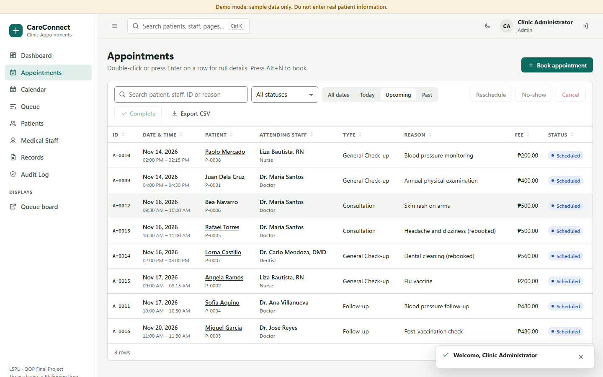
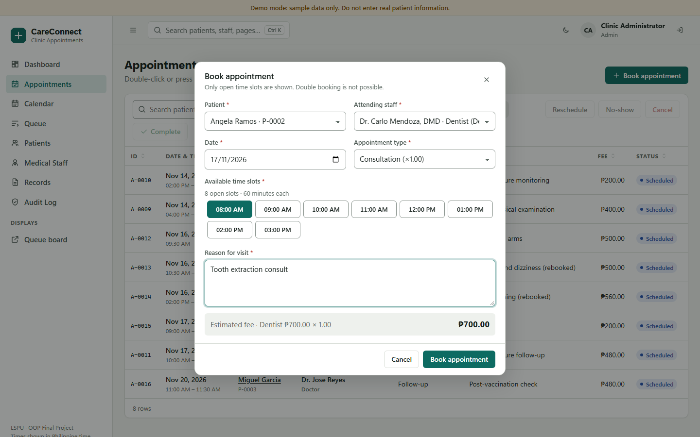
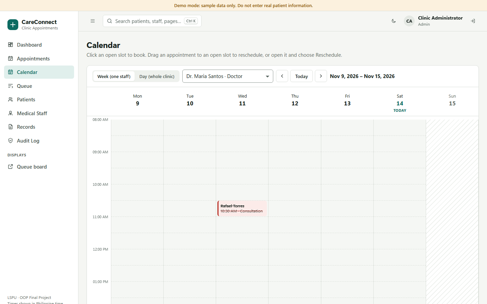
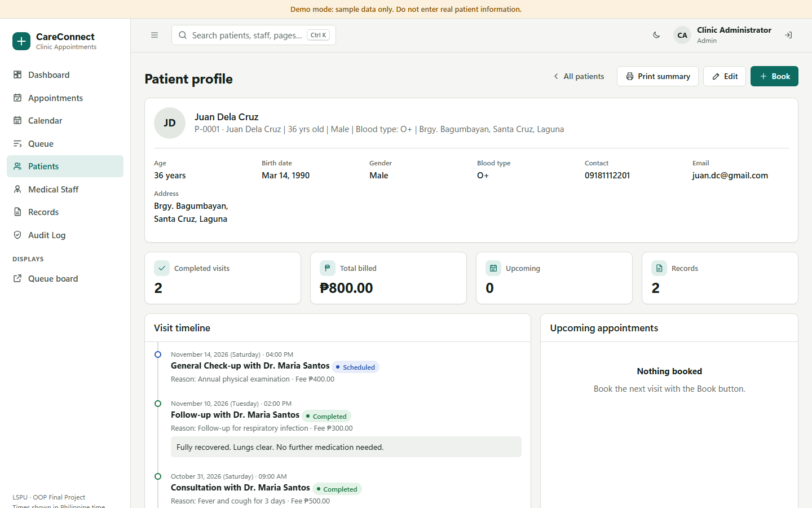
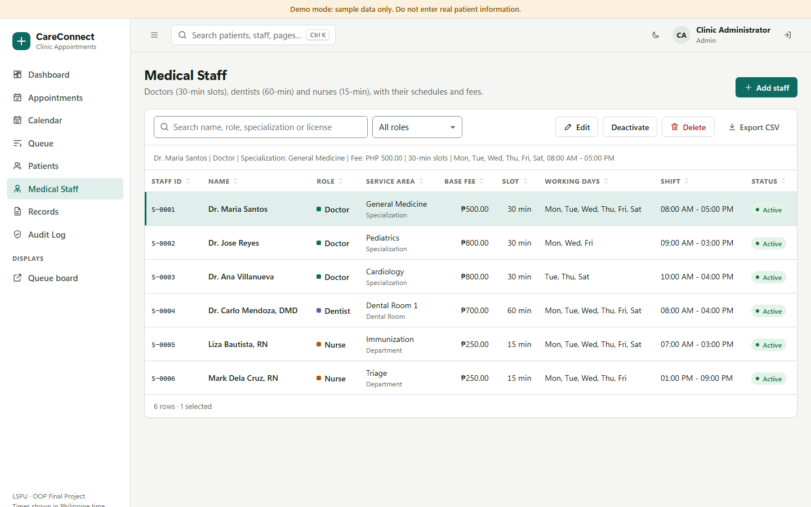
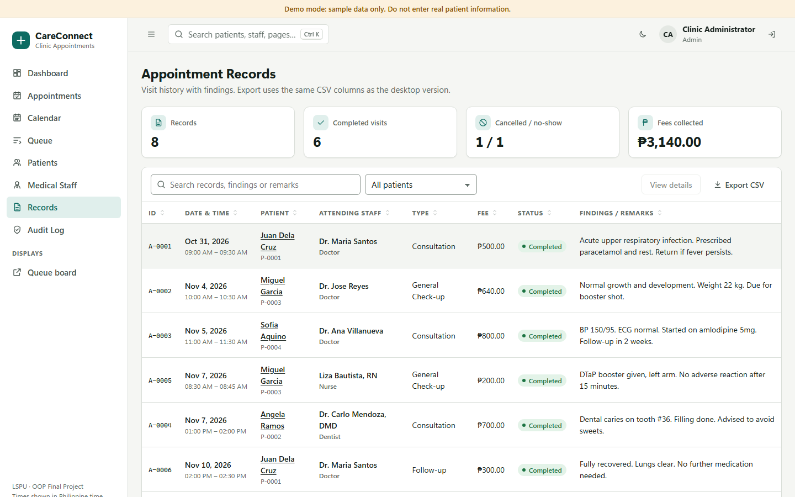
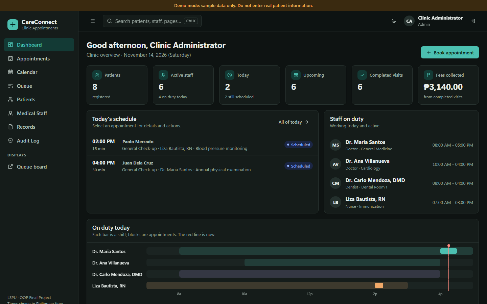

# CareConnect: Clinic Appointment Management System

A web application for managing **patient registration, medical staff, appointment scheduling and appointment
records** in a clinic. It was built as the final project for **Object-Oriented Programming (Scenario 3)** at
Laguna State Polytechnic University and demonstrates the four pillars of OOP: **Encapsulation, Inheritance,
Polymorphism and Abstraction**.

This branch (`javascript-version`) holds the **JavaScript web version** in [`web/`](web/). It runs in any
browser and deploys to Render as a Node.js web service. The original **Java Swing desktop version** is still
in [`src/`](src/) (see [Java desktop version](#java-desktop-version) below).


## Features

- **Dashboard:** patient and staff counts, today's schedule, staff on duty, an on-duty timeline, fees collected, and charts (appointments per day, status breakdown, fees by staff type, busiest staff), each with a text summary and a table view
- **Patients:** register, edit, search and delete, with validation (PH mobile numbers, birth date and so on), plus a patient profile with visit timeline and findings
- **Medical staff:** Doctors, Dentists and Nurses with specialization, PRC license, working days and shift hours; activate or deactivate
- **Appointments:** book only *available* slots, with no double booking of staff or patient; reschedule, complete with findings, cancel with a reason (with undo), or mark no-show; printable appointment slip
- **Calendar:** week view per staff member and day view for the clinic; drag an appointment to reschedule
- **Automatic fees:** staff type (Doctor / Dentist / Nurse) × appointment type (Consultation, Follow-up, Check-up, Emergency)
- **Appointment records:** visit history per patient, totals, CSV export
- **Accounts and roles:** Admin, Receptionist and Doctor (a doctor sees only their own schedule and patients)
- **Queue board:** a "now serving" screen for the waiting area that updates live
- **Audit log, Ctrl+K search, dark mode, keyboard shortcuts, phone-friendly layout**

| Appointments | Book an appointment |
|---|---|
|  |  |
| **Calendar** | **Patient profile** |
|  |  |
| **Medical staff** | **Appointment records** |
|  |  |
| **Queue board** | **Dark mode** |
|  |  |

## Run it on your computer

**Requirement:** [Node.js](https://nodejs.org/) 24 or newer.

```bash
cd web
npm install
npm start
```

Open <http://localhost:3000> and sign in with one of the demo accounts shown on the sign-in page:

| Role | Username | Password | Can do |
|---|---|---|---|
| Admin | `admin` | `admin123` | Everything, including staff changes and the audit log |
| Receptionist | `reception` | `reception123` | Patients, booking, records (clinical findings hidden) |
| Doctor | `drsantos` | `doctor123` | Dr. Maria Santos's own schedule and patients; record findings |

The sample data (8 patients, 6 staff, about 16 appointments around today's date) loads automatically the
first time. Data is saved in `web/data/`; delete that folder to start over with fresh sample data.
The queue board is at <http://localhost:3000/board>.

## Run it online (Render)

1. Sign in at <https://render.com> with your GitHub account.
2. Click **New + → Blueprint**, connect this repository and choose the **`javascript-version`** branch. Render reads [`render.yaml`](render.yaml).
3. Click **Apply**. Render runs `npm ci` and `npm start` in `web/` and checks `/api/health`.
4. Open the service URL, for example `https://careconnect-web.onrender.com`.

Notes for the free plan:
- The service sleeps after about 15 minutes without visitors, so the first visit afterwards takes about a minute.
- The disk is temporary: data returns to the sample data after every deploy or restart.
- Demo mode is on, so the demo accounts are listed on the sign-in page. Use made-up data only. To hide them,
  set `DEMO_MODE` to `false` and add `ADMIN_PASSWORD`, `RECEPTION_PASSWORD` and `DOCTOR_PASSWORD`
  (10+ characters each) under **Environment** in the Render dashboard.

## Settings

| Variable | Default | Meaning |
|---|---|---|
| `PORT` | `3000` | Port to listen on (Render sets this) |
| `STORAGE` | `json` | `json` (files in `DATA_DIR`), `sqlite` (Node's built-in SQLite) or `memory` |
| `DATA_DIR` | `web/data` | Where data files are saved |
| `DEMO_MODE` | `true` | Show the demo accounts and the "sample data only" banner |
| `ADMIN_PASSWORD`, `RECEPTION_PASSWORD`, `DOCTOR_PASSWORD` | – | Account passwords when `DEMO_MODE=false` |
| `CLINIC_TIME_ZONE` | `Asia/Manila` | The clinic's clock (servers often run on UTC) |
| `NODE_ENV` | – | `production` turns on secure cookies, HSTS and proxy support |

## Tests

```bash
cd web
npm test                 # 177 unit and API tests (node:test)
npm run test:coverage    # fails below 90% line coverage on domain, services, repositories
npx playwright install chromium   # once, for the end-to-end tests
npm run test:e2e         # Playwright: register → book → double booking blocked → complete → records → CSV, and more
npm run verify           # lint + type check + coverage + class-diagram check
```

`npm run check:diagrams` compares the UML class diagrams in [docs/DOCUMENTATION.md](docs/DOCUMENTATION.md)
with the code and fails if any class, member or `extends` arrow does not exist.
`npm run docs:images` regenerates the screenshots and diagram images.

## Project structure

```
web/
├── server.js                  Starts the app (reads the settings above)
├── src/
│   ├── domain/                The OOP core, shared by the server and the browser
│   │   ├── Person.js          abstract: base of every person
│   │   ├── Patient.js         extends Person
│   │   ├── MedicalStaff.js    abstract: extends Person
│   │   ├── Doctor.js, Dentist.js, Nurse.js   extend MedicalStaff
│   │   ├── Appointment.js     links Patient and MedicalStaff; status changes only through its methods
│   │   ├── AppointmentStatus.js, AppointmentType.js, Enumeration.js   enum classes
│   │   ├── contracts.js       Identifiable / Searchable / Billable "interfaces"
│   │   ├── StaffFactory.js    creates the right MedicalStaff subclass
│   │   ├── mappers.js         turn objects into JSON records and back
│   │   └── time/              CalendarDate, TimeOfDay, DayOfWeek, Clock (Asia/Manila)
│   ├── repositories/          Repository (abstract) → InMemory → JsonFile / Sqlite
│   ├── services/              ClinicService (business rules), Stats, AuditLog, Queue, SampleDataLoader
│   ├── auth/                  AuthService, scrypt PasswordHasher, sessions, AccessPolicy per role
│   └── api/                   Express app and one Controller subclass per resource
├── public/
│   ├── index.html, board.html, styles/
│   └── app/                   App, pages (BasePage → ListPage → …), dialogs (BaseDialog → FormDialog → …),
│                              <cc-data-table>, <cc-stat-card>, charts, calendar, command palette
├── test/                      unit/, api/, e2e/
└── scripts/                   check-diagrams.js, capture-docs.js
docs/
├── DOCUMENTATION.md           Overview, objectives, architecture, class diagrams, four pillars, features
├── CareConnect-Documentation.docx   Word version for submission
├── diagrams/web/              Class diagrams as PNG images (for slides)
└── screenshots/web/
render.yaml                    Render Blueprint (Node web service)
```

## OOP pillars at a glance

| Pillar | Where to look (in `web/`) |
|---|---|
| **Encapsulation** | `#private` fields with validating `set` accessors in `Person`, `Patient`, `MedicalStaff`. `Appointment` has no status setter: the status changes only through `complete()`, `cancel()`, `markNoShow()` and `reschedule()`. Dates and times are frozen value objects. |
| **Inheritance** | `Person → Patient / MedicalStaff → Doctor / Dentist / Nurse`; `ClinicError extends Error`; `JsonFileRepository extends InMemoryRepository extends Repository`; UI: `PatientsPage extends ListPage extends BasePage`, `PatientDialog extends FormDialog extends BaseDialog` |
| **Polymorphism** | `getConsultationFee()`, `getSlotDurationMinutes()`, `getDisplayName()` and `getDetails()` overridden per staff type; the app calls `mount()`/`refresh()` on whichever page is open; `findAppointments(criteria)` picks the search from the argument's type (JavaScript has no overloading) |
| **Abstraction** | Abstract classes guarded with `new.target` (`Person`, `MedicalStaff`, `Repository`, `BasePage`, `FormDialog`, `Chart`, `Controller`, `AccessPolicy`); "interfaces" `Identifiable`, `Searchable`, `Billable` checked by `implementsInterface()` |

The full explanation with file and line references, and the UML class diagrams, are in
[docs/DOCUMENTATION.md](docs/DOCUMENTATION.md).

## Java desktop version

The original Java Swing version is unchanged in `src/clinic/` (and on the `main` branch).

**Requirement:** Java JDK 17 or newer. On Windows, double-click `run.bat`. On any OS:

```bash
javac --release 17 -encoding UTF-8 -d out $(find src -name "*.java")
java -cp out clinic.Main
```

## Group members

| Name | Contribution |
|---|---|
| _Member 1_ | _Domain classes and objectives_ |
| _Member 2_ | _Services, API, tests, class diagrams_ |
| _Member 3_ | _User interface and system demo_ |

---
Laguna State Polytechnic University · Object-Oriented Programming · Final Project
