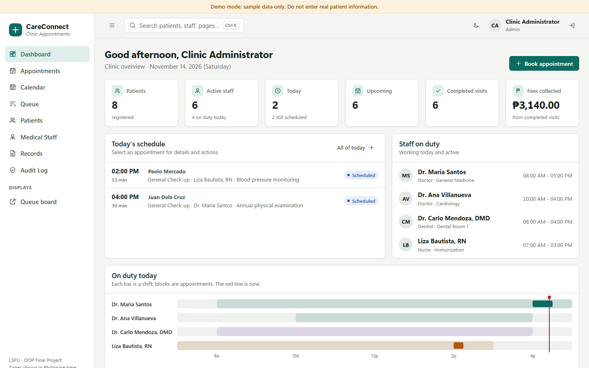
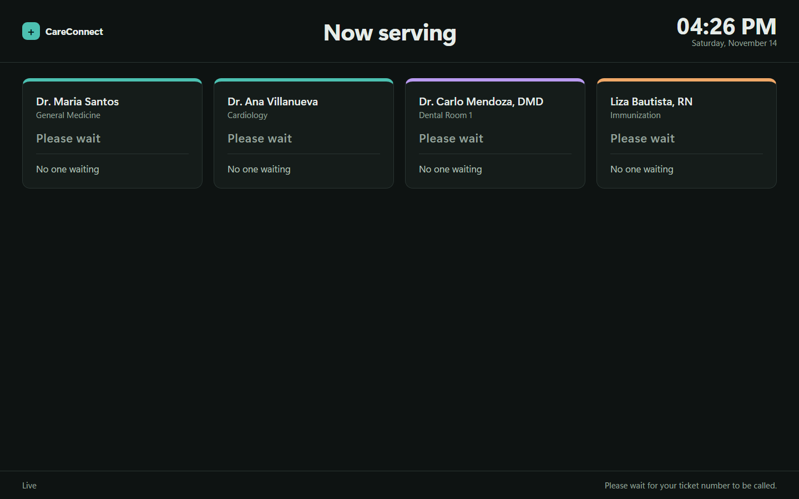

# CareConnect: Clinic Appointment Management System

A web application for managing **patient registration, medical staff, appointment scheduling and appointment
records** in a clinic. It was built as the final project for **Object-Oriented Programming (Scenario 3)** at
Laguna State Polytechnic University and demonstrates the four pillars of OOP: **Encapsulation, Inheritance,
Polymorphism and Abstraction**.

The system is a **JavaScript web application** (Node.js + vanilla JavaScript) in [`web/`](web/). It runs in any
browser and is deployed to Render as a Node.js web service with a Neon PostgreSQL database. The earlier **Java
Swing desktop version** of the same system is kept in [`src/`](src/) (see
[Java desktop version](#java-desktop-version) below).

> ### Live system
> **<https://careconnect-web-qwno.onrender.com>**
>
> - It is the official version: the clinic starts empty and there are no demo accounts. You sign in with an
>   account created by the clinic's administrator.
> - The free server sleeps when nobody uses it, so the **first visit can take about a minute** to load.
> - To try it without an account, run the demo on your own computer: see [Run it on your computer](#run-it-on-your-computer).



## Using the website

After signing in, the menu on the left shows only the pages your role may use.

| Page | What you do there | Admin | Receptionist | Doctor |
|---|---|:-:|:-:|:-:|
| **Dashboard** | Today's schedule, staff on duty, fees collected, charts | ✔ | ✔ | ✔ (own) |
| **Appointments** | Book an open slot, reschedule, cancel with a reason, mark no-show; complete a visit with findings (Admin and Doctor only) | ✔ | ✔ (cannot complete) | ✔ (own, cannot book) |
| **Calendar** | Week view per staff member, day view for the clinic; drag to reschedule | ✔ | ✔ | ✔ (own) |
| **Queue** | Check patients in and call the next one; opens the waiting-room board at `/board` | ✔ | ✔ | ✔ |
| **Patients** | Register, edit, search, delete; open a patient's profile and visit timeline | ✔ | ✔ | view only (own patients) |
| **Medical Staff** | Add and edit Doctors, Dentists and Nurses; activate or deactivate | ✔ | view only | view only |
| **Records** | History of completed, cancelled and no-show visits; export CSV | ✔ | ✔ (no findings) | ✔ (own) |
| **Audit Log** | Who changed what and when | ✔ | | |
| **Accounts** | Create accounts, change roles, deactivate, reset passwords | ✔ | | |

**First time on a new clinic (administrator):**

1. Sign in with the administrator account set up on the server.
2. Open **Medical Staff → Add staff** and add the doctors, dentists and nurses with their working days and shift.
3. Open **Accounts → New account** and create sign-ins for the receptionists and doctors (a doctor's account is linked to their staff record).
4. Open **Patients → Register patient**, then **Appointments → Book appointment**. Only open time slots are offered, so double booking is not possible.

Press **Ctrl+K** to search or jump to any page, **Alt+N** to book an appointment, and use the key icon at the top to
change your own password.

## Features

- **Dashboard:** patient and staff counts, today's schedule, staff on duty, an on-duty timeline, fees collected, and charts (appointments per day, status breakdown, fees by staff type, busiest staff), each with a text summary and a table view
- **Patients:** register, edit, search and delete, with validation (PH mobile numbers, birth date and so on), plus a patient profile with visit timeline and findings
- **Medical staff:** Doctors, Dentists and Nurses with specialization, PRC license, working days and shift hours; activate or deactivate
- **Appointments:** book only *available* slots, with no double booking of staff or patient; reschedule, complete with findings, cancel with a reason (with undo), or mark no-show; printable appointment slip
- **Calendar:** week view per staff member and day view for the clinic; drag an appointment to reschedule
- **Automatic fees:** staff type (Doctor / Dentist / Nurse) × appointment type (Consultation, Follow-up, Check-up, Emergency)
- **Appointment records:** visit history per patient, totals, CSV export
- **Accounts and roles:** Admin, Receptionist and Doctor (a doctor sees only their own schedule and patients); the administrator creates, edits, deactivates and resets accounts, and everyone can change their own password
- **Permanent storage:** PostgreSQL (for example a free Neon database), JSON files or SQLite
- **Queue board:** a "now serving" screen for the waiting area that updates live
- **Audit log, Ctrl+K search, dark mode, keyboard shortcuts, phone-friendly layout**

| Appointments | Book an appointment |
|---|---|
|  |  |
| **Calendar** | **Patient profile** |
|  |  |
| **Medical staff** | **Appointment records** |
|  |  |
| **Queue board** | **Dark mode** |
|  |  |

## Run it on your computer

**Requirement:** [Node.js](https://nodejs.org/) 24 or newer.

**Demo (for presentations):** sample data and three demo accounts shown on the sign-in page.

```bash
cd web
npm install
npm run demo
```

Open <http://localhost:3000> and pick a demo account (`admin` / `admin123`, `reception` / `reception123`,
`drsantos` / `doctor123`). Demo data is kept separately in `web/data/demo/`.

**Official (real use):** the clinic starts empty, there are no demo accounts, and the first administrator
comes from your settings. Every other account is created inside the app under **Accounts**.

```bash
cd web
ADMIN_USERNAME=owner ADMIN_PASSWORD='choose-a-long-password' npm start
```

(On Windows PowerShell: `$env:ADMIN_USERNAME='owner'; $env:ADMIN_PASSWORD='choose-a-long-password'; npm start`.)
Without `DATABASE_URL`, records are saved in `web/data/`.

| Role | Can do |
|---|---|
| Admin | Everything, including staff changes, accounts and the audit log |
| Receptionist | Patients, booking, records (clinical findings hidden) |
| Doctor | Their own schedule and patients (the account is linked to a staff record); record findings |

The queue board for the waiting area is at `/board`.

## Put it online (Render + Neon, free)

Render's free disk is wiped whenever the service sleeps or redeploys, so the official site keeps its data in a
free **Neon** PostgreSQL database instead.

1. **Create the database.** Sign up at <https://neon.tech> (free, no card), create a project, choose the region
   **AWS US West 2 (Oregon)** (the same region as Render's default), and copy the **connection string**
   (it starts with `postgresql://` and ends with `?sslmode=require`).
2. **Create the service.** In Render click **New + → Blueprint**, connect this repository and choose the
   **`main`** branch. Render reads [`render.yaml`](render.yaml) and asks for three values:
   - `DATABASE_URL`: the Neon connection string
   - `ADMIN_USERNAME`: the administrator's username, for example `owner`
   - `ADMIN_PASSWORD`: a private password of at least 10 characters
3. Click **Apply**. When the service shows **Live**, open its URL and sign in as the administrator.
4. Go to **Medical Staff** to add the clinic's doctors, dentists and nurses, then **Accounts** to create the
   receptionists' and doctors' sign-ins. Each person can change their own password with the key icon.

Already created the service earlier? Open it in Render → **Environment**, add the three values above
(and remove `DEMO_MODE` if it is there), then **Save and deploy**.

Notes:
- The free service sleeps after about 15 minutes without visitors; the first visit afterwards takes about a minute.
  Records are safe in Neon while it sleeps.
- Changing `ADMIN_PASSWORD` later does not change an existing administrator's password: use the key icon in the app.
- If you store real patient information, follow the Data Privacy Act of 2012 (RA 10173): give accounts only to
  clinic staff, deactivate accounts of people who leave, and keep the Neon and Render logins private.

## Settings

| Variable | Default | Meaning |
|---|---|---|
| `PORT` | `3000` | Port to listen on (Render sets this) |
| `DATABASE_URL` | – | PostgreSQL connection string. When set, every record and account is stored there. |
| `STORAGE` | `postgres` if `DATABASE_URL` is set, else `json` | `postgres`, `json` (files in `DATA_DIR`), `sqlite` or `memory` |
| `DATA_DIR` | `web/data` (demo: `web/data/demo`) | Where json/sqlite data is saved |
| `ADMIN_USERNAME` | `admin` | First administrator's username (official mode) |
| `ADMIN_PASSWORD` | – | First administrator's password, 10+ characters. Used once, when no administrator exists. |
| `SAMPLE_DATA` | `false` | `true` loads the sample records into an empty clinic in official mode |
| `DEMO_MODE` | `false` | `true` (or `npm run demo`) turns on demo accounts, sample data and the demo banner |
| `CLINIC_TIME_ZONE` | `Asia/Manila` | The clinic's clock (servers often run on UTC) |
| `NODE_ENV` | – | `production` turns on secure cookies, HSTS and proxy support |

## Tests

```bash
cd web
npm test                 # unit and API tests (node:test), including PostgreSQL via pg-mem
npm run test:coverage    # fails below 90% line coverage on domain, services, repositories
npx playwright install chromium   # once, for the end-to-end tests
npm run test:e2e         # Playwright: register → book → double booking blocked → complete → records → CSV, and more
npm run verify           # lint + type check + coverage + class-diagram check
```

`npm run check:diagrams` compares the UML class diagrams in [docs/DOCUMENTATION.md](docs/DOCUMENTATION.md)
with the code and fails if any class, member or `extends` arrow does not exist.
`npm run docs:images` regenerates the screenshots and diagram images, and `npm run docs:word` rebuilds
`docs/CareConnect-Documentation.docx` from `DOCUMENTATION.md`. On Windows with Microsoft Word,
`powershell -File scripts/update-word-toc.ps1` then fills in the table of contents.

## Project structure

```
web/
├── server.js                  Starts the app (reads the settings above)
├── src/
│   ├── domain/                The OOP core, shared by the server and the browser
│   │   ├── Person.js          abstract: base of every person
│   │   ├── Patient.js         extends Person
│   │   ├── MedicalStaff.js    abstract: extends Person
│   │   ├── Doctor.js, Dentist.js, Nurse.js   extend MedicalStaff
│   │   ├── Appointment.js     links Patient and MedicalStaff; status changes only through its methods
│   │   ├── AppointmentStatus.js, AppointmentType.js, Enumeration.js   enum classes
│   │   ├── contracts.js       Identifiable / Searchable / Billable "interfaces"
│   │   ├── StaffFactory.js    creates the right MedicalStaff subclass
│   │   ├── mappers.js         turn objects into JSON records and back
│   │   └── time/              CalendarDate, TimeOfDay, DayOfWeek, Clock (Asia/Manila)
│   ├── repositories/          Repository (abstract) → InMemory → JsonFile / Sqlite / Postgres
│   ├── services/              ClinicService (business rules), Stats, AuditLog, Queue, SampleDataLoader
│   ├── auth/                  User accounts, AuthService, scrypt PasswordHasher, sessions, AccessPolicy per role
│   └── api/                   Express app and one Controller subclass per resource
├── public/
│   ├── index.html, board.html, styles/
│   └── app/                   App, pages (BasePage → ListPage → …), dialogs (BaseDialog → FormDialog → …),
│                              <cc-data-table>, <cc-stat-card>, charts, calendar, command palette
├── test/                      unit/, api/, e2e/
└── scripts/                   check-diagrams.js, capture-docs.js
docs/
├── DOCUMENTATION.md           Overview, objectives, architecture, class diagrams, four pillars, features
├── CareConnect-Documentation.docx   Word version for submission
├── diagrams/web/              Class diagrams as PNG images (for slides)
└── screenshots/web/
render.yaml                    Render Blueprint (Node web service)
```

## OOP pillars at a glance

| Pillar | Where to look (in `web/`) |
|---|---|
| **Encapsulation** | `#private` fields with validating `set` accessors in `Person`, `Patient`, `MedicalStaff`. `Appointment` has no status setter: the status changes only through `complete()`, `cancel()`, `markNoShow()` and `reschedule()`. Dates and times are frozen value objects. |
| **Inheritance** | `Person → Patient / MedicalStaff → Doctor / Dentist / Nurse`; `ClinicError extends Error`; `JsonFileRepository extends InMemoryRepository extends Repository`; UI: `PatientsPage extends ListPage extends BasePage`, `PatientDialog extends FormDialog extends BaseDialog` |
| **Polymorphism** | `getConsultationFee()`, `getSlotDurationMinutes()`, `getDisplayName()` and `getDetails()` overridden per staff type; the app calls `mount()`/`refresh()` on whichever page is open; `findAppointments(criteria)` picks the search from the argument's type (JavaScript has no overloading) |
| **Abstraction** | Abstract classes guarded with `new.target` (`Person`, `MedicalStaff`, `Repository`, `BasePage`, `FormDialog`, `Chart`, `Controller`, `AccessPolicy`); "interfaces" `Identifiable`, `Searchable`, `Billable` checked by `implementsInterface()` |

The full explanation with file and line references, and the UML class diagrams, are in
[docs/DOCUMENTATION.md](docs/DOCUMENTATION.md).

## Java desktop version

The original Java Swing version of the system is kept, unchanged, in `src/clinic/`. The web version above is
a rebuild of it in JavaScript with the same features and business rules.

**Requirement:** Java JDK 17 or newer. On Windows, double-click `run.bat`. On any OS:

```bash
javac --release 17 -encoding UTF-8 -d out $(find src -name "*.java")
java -cp out clinic.Main
```

## Group members

| Name | Contribution |
|---|---|
| Lovelyn Genovania | Project overview and objectives; patient registration; documentation |
| Jun Dave Ofrin | Medical personnel classes; UML class diagrams |
| Yyah Jannah Pacia | Appointment scheduling, records and fees; automated tests |
| Andrei Joseph Palis | Web interface; sign-in and roles; deployment; system demo |

With the instructor's permission, this group has four members.
The presentation script is in [`docs/PRESENTATION-SCRIPT.md`](docs/PRESENTATION-SCRIPT.md).

---
Laguna State Polytechnic University · Object-Oriented Programming · Final Project
