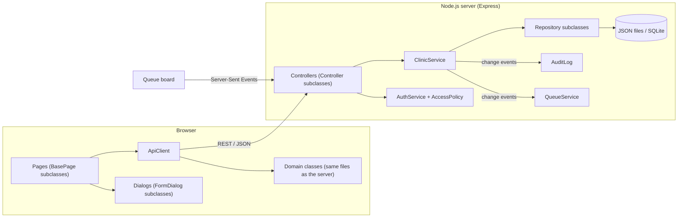
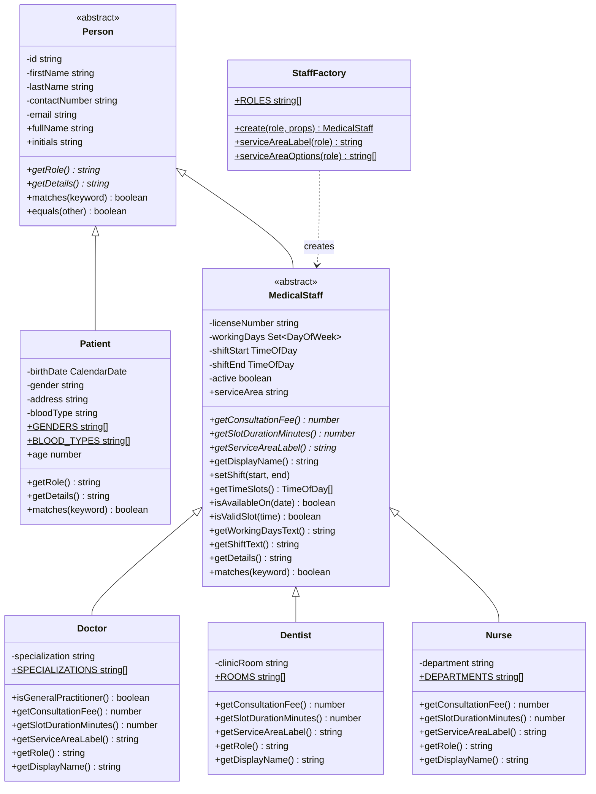
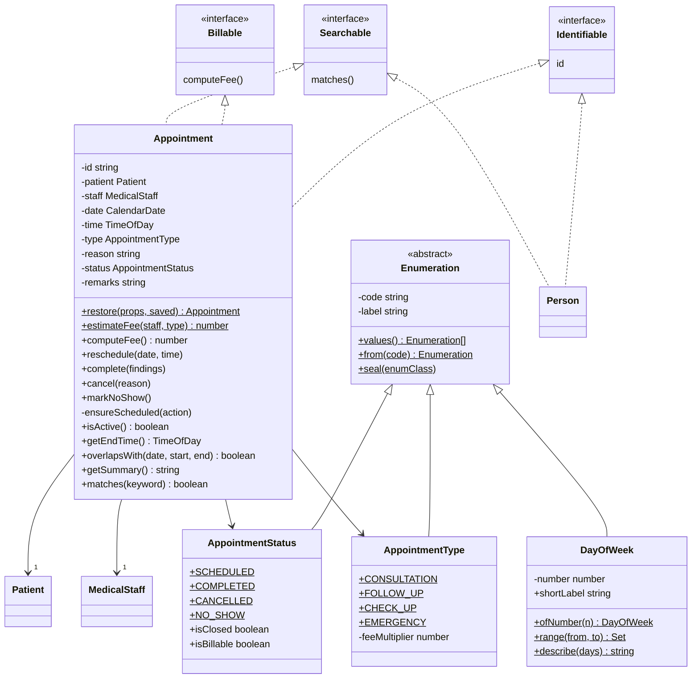
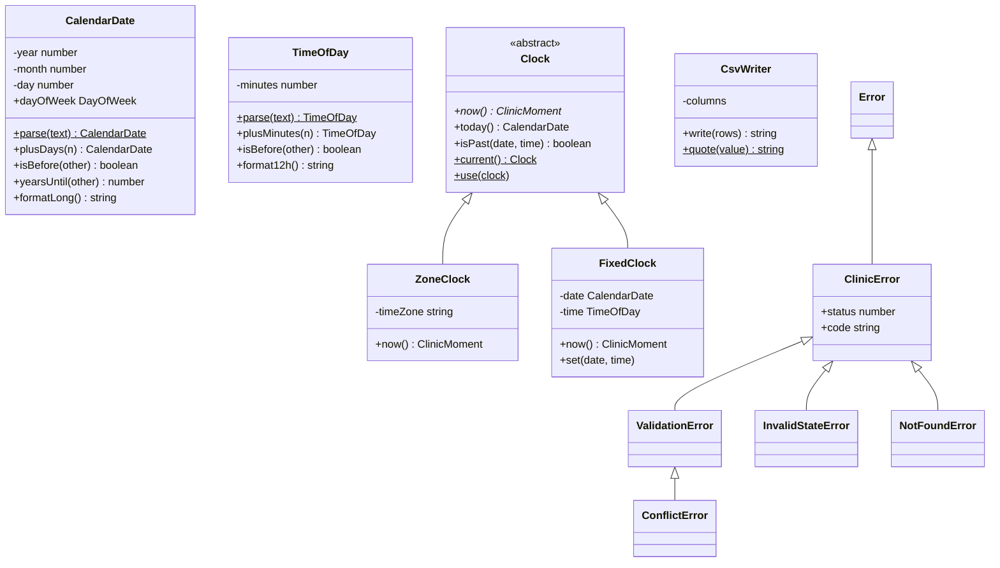
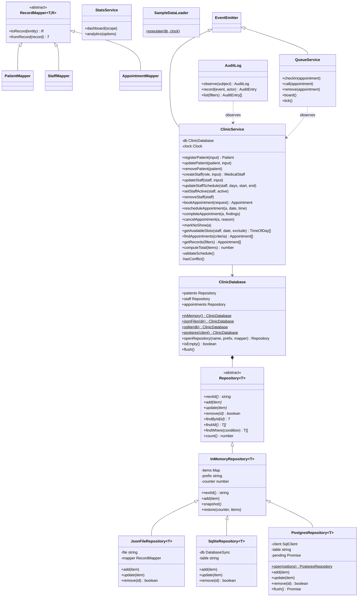
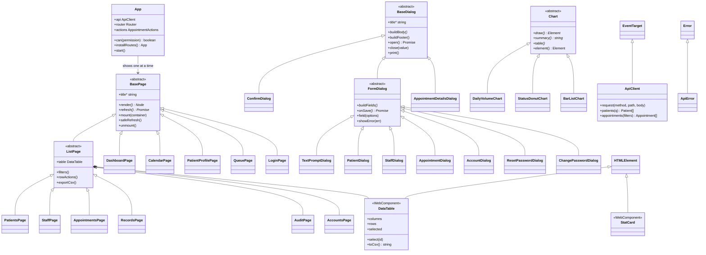

# CareConnect: Clinic Appointment Management System (JavaScript Web Version)

**Object-Oriented Programming Final Project, Scenario 3: Clinic Appointment Management System**
Laguna State Polytechnic University

| Group Members | Role / Contribution |
|---|---|
| _Member 1 Name_ | _e.g. Domain classes (Person, Patient, MedicalStaff, Doctor, Dentist, Nurse, Appointment)_ |
| _Member 2 Name_ | _e.g. ClinicService, repositories, REST API, tests_ |
| _Member 3 Name_ | _e.g. Browser pages, dialogs, class diagrams and documentation_ |

> This branch (`javascript-version`) contains the web version in the `web/` folder. The original Java Swing
> version is unchanged in `src/` (and on the `main` branch).

---

## 1. Project Overview

**CareConnect** is a web application that manages the daily appointment work of a small clinic:
registering patients, keeping a list of medical personnel and their schedules, booking and tracking
appointments, and keeping a history of every visit. It runs in any browser and is deployed as a
Node.js web service on Render.

It is a rebuild of the team's Java Swing desktop version in **JavaScript**. Every feature and business
rule of the Java version was kept and covered by automated tests, and the object-oriented design was
carried over class by class: the same abstract classes, subclasses, overridden methods and "interfaces".

### The problem it addresses

Many small clinics and school infirmaries still use paper logbooks or loose spreadsheets for appointments:

- **Double booking.** Two patients get the same doctor at the same time, or one patient is booked in two places at once.
- **Bookings outside working hours.** Appointments land on a doctor's day off or after the shift ends.
- **Lost or scattered records.** It is hard to see a patient's past visits, findings and missed appointments.
- **Inconsistent fees.** Fees are computed by hand and vary depending on who computes them.
- **No overview.** Staff cannot quickly see today's schedule, who is on duty, or who is waiting.

### What the system does

- Stores patients and medical staff (Doctors, Dentists and Nurses) with validated information.
- Offers **only the open time slots** when booking, and blocks double booking of both the staff member and the patient.
- Tracks each appointment through its life cycle: **Scheduled → Completed / Cancelled / No-Show**.
- Computes fees automatically from the type of staff and the type of visit.
- Keeps a searchable **appointment-records history** per patient, exportable to CSV.
- Adds what a web version makes possible: sign-in with roles, a calendar with drag-to-reschedule, dashboard
  charts, patient profiles, an audit log, and a live "now serving" queue board for the waiting area.

---

## 2. Project Objectives

### General Objective

To develop a web-based **Clinic Appointment Management System** in JavaScript that applies the four pillars of
Object-Oriented Programming (Encapsulation, Inheritance, Polymorphism and Abstraction) to make patient
registration, medical-personnel management, appointment scheduling and record keeping in a clinic faster
and more reliable, and that anyone can open in a browser.

### Specific Objectives

1. **Patient registration.** Register, edit, search and remove patients, validating names, birth date and Philippine mobile numbers.
2. **Medical-personnel management.** Manage Doctors, Dentists and Nurses with their specialization or area, PRC license, working days and shift; activate or deactivate them.
3. **Conflict-free scheduling.** Book only available slots and prevent double booking of the same staff member or patient.
4. **Appointment tracking.** Reschedule, complete (with findings), cancel (with a reason) or mark no-show, only while an appointment is still scheduled.
5. **Automatic fee computation.** Staff base fee × appointment-type multiplier.
6. **Appointment records.** History of completed, cancelled and no-show visits per patient, with totals and CSV export.
7. **Secure, role-based access.** Admin, Receptionist and Doctor accounts, each seeing only what it should.
8. **Demonstrate OOP in JavaScript.** Apply the four pillars in real code and keep the UML class diagrams in step with it (checked automatically by `npm run check:diagrams`).

---

## 3. Architecture

| Layer | Folder | What it holds |
|---|---|---|
| Domain | `web/src/domain/` | Plain ES classes with no framework imports. **The browser loads the very same files** (served at `/domain/`) to validate forms and to turn API data back into real `Doctor`, `Patient` and `Appointment` objects. |
| Repositories | `web/src/repositories/` | `Repository` (abstract) → `InMemoryRepository` → `JsonFileRepository` / `SqliteRepository` / `PostgresRepository`. Online, everything is stored in PostgreSQL (a free Neon database). |
| Services | `web/src/services/` | `ClinicService` (every business rule), `StatsService`, `AuditLog`, `QueueService`, `SampleDataLoader`. |
| Sign-in and roles | `web/src/auth/` | `User` accounts (stored with the clinic records), `AuthService`, `PasswordHasher` (scrypt), `SessionStore`, `AccessPolicy` and its role subclasses. |
| REST API | `web/src/api/` | Express app, one `Controller` subclass per resource, request validation and error handling. |
| Browser app | `web/public/app/` | `App`, pages, Web Components (`<cc-data-table>`, `<cc-stat-card>`), dialogs, charts, calendar, command palette. |

**Time zone.** Render's servers run on UTC, but the clinic is in the Philippines. Every "today" and "now"
comes from a `Clock` object set to `Asia/Manila`, and the tests use a `FixedClock` so the past/future rules
are tested on any day. Dates and times are the value objects `CalendarDate` and `TimeOfDay` (the
JavaScript counterparts of Java's `LocalDate` and `LocalTime`).

---

## 4. Class Diagrams

The diagrams below list the important members of each class. `-` is private (`#field` in JavaScript),
`+` is public, `*` marks an abstract method, `$` marks a static member. Every class, member and
`extends` arrow shown here is checked against the source code by `npm run check:diagrams`.

### 4.1 People and medical staff

### 4.2 Appointments, enums and "interfaces"

### 4.3 Value objects, clock and errors

### 4.4 Repositories and services

### 4.5 Sign-in, roles and the REST API

```mermaid
classDiagram
  class User {
    -passwordHash string
    -username string
    -displayName string
    -role UserRole
    -staffId string
    -active boolean
    +setRole(role, staffId)
    +verifyPassword(password, hasher) Promise
    +setPasswordHash(hash)
    +toPublic() object
    +toRecord() UserRecord
  }
  class UserMapper {
    +toRecord(user) UserRecord
    +fromRecord(record) User
  }
  class UserRole
  class AuthService {
    +seedDemoAccounts()
    +ensureAdministrator(settings)
    +needsSetup() boolean
    +login(username, password, address)
    +logout(token)
    +userForToken(token) User
    +listUsers() User[]
    +createUser(input) User
    +updateUser(actor, id, input) User
    +resetPassword(id, password)
    +changeOwnPassword(user, current, next, keepToken)
  }
  class PasswordHasher {
    +hash(password) Promise
    +verify(password, stored) Promise
  }
  class SessionStore {
    +create(userId) string
    +touch(token)
    +destroy(token)
    +destroyForUser(userId, keepToken)
  }
  class RateLimiter {
    +retryAfter(key) number
    +hit(key)
    +reset(key)
  }
  class AccessPolicy {
    <<abstract>>
    +for(user)$ AccessPolicy
    +can(permission)* boolean
    +staffScope string
    +canAccess(appointment) boolean
    +permissions() string[]
  }
  class AdminPolicy {
    +can() boolean
  }
  class ReceptionistPolicy {
    +can(permission) boolean
  }
  class DoctorPolicy {
    -staffId string
    +can(permission) boolean
    +staffScope string
  }
  class Controller {
    <<abstract>>
    +basePath* string
    +routes(router)*
    +router() Router
    +appointmentFor(req, id) Appointment
    +patientFor(req, id) Patient
    +view(req)
  }
  class PatientController
  class StaffController
  class AppointmentController
  class RecordController
  class StatsController
  class AuthController
  class AuditController
  class QueueController
  class MetaController
  class UserController
  Enumeration <|-- UserRole
  AccessPolicy <|-- AdminPolicy
  AccessPolicy <|-- ReceptionistPolicy
  AccessPolicy <|-- DoctorPolicy
  Controller <|-- PatientController
  Controller <|-- StaffController
  Controller <|-- AppointmentController
  Controller <|-- RecordController
  Controller <|-- StatsController
  Controller <|-- AuthController
  Controller <|-- AuditController
  Controller <|-- QueueController
  Controller <|-- MetaController
  Controller <|-- UserController
  RecordMapper <|-- UserMapper
  AuthService --> PasswordHasher
  AuthService --> SessionStore
  AuthService --> RateLimiter
  AuthService ..> AccessPolicy : creates
```

### 4.6 Browser user interface

### 4.7 Relationships

| Relationship | Example |
|---|---|
| **Inheritance** (`extends`) | `Doctor extends MedicalStaff extends Person`; `JsonFileRepository extends InMemoryRepository extends Repository`; `PatientsPage extends ListPage extends BasePage` |
| **Realization** (contract) | `Appointment` implements `Identifiable`, `Billable`, `Searchable` (declared in `static implements`) |
| **Association** | `Appointment` → one `Patient` and one `MedicalStaff` |
| **Composition** | `ClinicDatabase` owns three repositories; `ListPage` owns its `DataTable` |
| **Dependency** | `StaffFactory` creates `MedicalStaff` subclasses; `AuditLog` and `QueueService` observe `ClinicService` |

---

## 5. Application of the Four Pillars of OOP

JavaScript has classes, `extends` and `super`, but it has no `abstract`, `interface`, `private` keyword
or method overloading. The table shows how each Java idea was expressed in JavaScript. All paths are
inside `web/`.

| Pillar | Java version | JavaScript version | Where to look |
|---|---|---|---|
| **Encapsulation** | `private` fields with validating setters; no `setStatus()` | `#private` fields; `get`/`set` accessors that validate; read-only `id`; no status setter, so the status changes only through `complete()`, `cancel()`, `markNoShow()`, `reschedule()`; frozen value objects | `src/domain/Person.js:30` (`#id`, getter only at `:54`), `src/domain/Person.js:78` (validating `set contactNumber`), `src/domain/Appointment.js:244` (`get status()` with no setter), `src/domain/Appointment.js:145` (`#ensureScheduled`), `src/domain/time/TimeOfDay.js:13` and `:21` (`#minutes`, `Object.freeze(this)`), `src/domain/MedicalStaff.js:119` (returns a frozen copy of the working days), `src/auth/User.js` (password hash never exposed) |
| **Inheritance** | `extends`, `super(...)` | `class Patient extends Person`, `class Doctor extends MedicalStaff`, each calling `super(props)`; error classes `ClinicError extends Error`; UI classes `PatientsPage extends ListPage extends BasePage`, `PatientDialog extends FormDialog extends BaseDialog`, `DataTable extends HTMLElement` | `src/domain/Patient.js:21`, `src/domain/MedicalStaff.js:29`, `src/domain/Doctor.js:10`, `src/domain/Dentist.js:9`, `src/domain/Nurse.js:10`, `src/domain/errors.js:10` and `:34`, `src/repositories/JsonFileRepository.js:20`, `public/app/pages/ListPage.js:13`, `public/app/components/dialogs/FormDialog.js:26`, `public/app/components/DataTable.js:38` |
| **Polymorphism** | overriding; five overloaded `findAppointments(...)` | Overriding: `getConsultationFee()`, `getSlotDurationMinutes()`, `getDisplayName()`, `getDetails()`, `matches()`, `render()`/`refresh()`, `can()`. **JavaScript has no overloading**, so `findAppointments(criteria)` checks the argument's type at runtime (`CalendarDate`, `Patient`, `MedicalStaff`, `AppointmentStatus`, keyword string or criteria object) and runs the matching search. This is honest runtime dispatch, not true compile-time overloading. | `src/domain/Doctor.js:33`, `src/domain/Dentist.js:25`, `src/domain/Nurse.js:26` (three fees), `src/domain/Appointment.js:94` (`estimateFee` calls whichever override applies), `src/services/ClinicService.js:381` (`findAppointments`), `src/services/ClinicService.js:446` (`computeTotal` works on any `Billable`), `src/auth/AccessPolicy.js:49` (one `can()` call, three answers), `public/app/App.js:217` (the app calls `mount()` on whatever page is current) |
| **Abstraction** | `abstract` classes and `interface`s | Abstract classes refuse `new` with `if (new.target === Person) throw …`; abstract methods throw "must implement" until a subclass overrides them; "interfaces" are frozen contracts (`Identifiable`, `Searchable`, `Billable`) checked by `implementsInterface(obj, contract)`; `Repository` hides whether data is in memory, JSON files or SQLite | `src/domain/Person.js:42`, `src/domain/MedicalStaff.js:42` and `:60` (abstract `getConsultationFee`), `src/domain/contracts.js:45` (`implementsInterface`), `src/repositories/Repository.js:13`, `src/domain/time/Clock.js` (abstract `Clock`), `public/app/pages/BasePage.js:20`, `public/app/components/charts.js:12` |

**Design patterns used:** Factory (`StaffFactory`, `AccessPolicy.for`), Repository, Observer
(`ClinicService` emits "change"; `AuditLog` and `QueueService` subscribe), Strategy (table column
definitions passed to `<cc-data-table>`), Template Method (`FormDialog` handles submitting and errors;
subclasses supply `buildFields()` and `onSave()`), and Value Object (`CalendarDate`, `TimeOfDay`, `AuditEntry`).

**Same classes in two places.** The browser imports `web/src/domain/*.js` directly. When the booking
dialog shows a fee estimate it calls `Appointment.estimateFee(staff, type)` on a real `Dentist` or
`Nurse` object, and when a patient form is saved the browser builds a real `Patient` first, so the
same validation messages appear before anything is sent. The server checks everything again.

---

## 6. System Features

| Area | Features |
|---|---|
| Dashboard | Patients, active staff, today's and upcoming appointments, completed visits, fees collected; today's schedule; staff on duty; an on-duty timeline with a "now" line; charts for appointments per day (14 days), status breakdown, fees by staff type and busiest staff, each with a text summary and a "Show as table" option |
| Patients | Register, edit, search (ID, name, phone, email, address), delete patients without history; patient profile with visit timeline, findings, total billed and upcoming visits |
| Medical staff | Add and edit Doctors, Dentists and Nurses; role filter; details line; activate or deactivate; delete staff without history |
| Appointments | Book open slots only, with a fee estimate; reschedule; complete with findings; cancel with a reason (undo within 10 seconds); no-show; filters by status and period; details window with a printable appointment slip |
| Calendar | Week view per staff member and day view for the whole clinic; click an open slot to book; drag an appointment to reschedule (the details window offers the same action for keyboard users) |
| Records | Closed appointments, per-patient filter, totals, CSV export with the same columns as the Java version |
| Queue | Check patients in and call them; a public board at `/board` updates live with Server-Sent Events and shows only per-day ticket numbers and initials |
| Accounts | Admin (everything), Receptionist (front desk: no staff changes, no clinical findings, no audit log), Doctor (own schedule and patients only). The first administrator comes from the server settings; the administrator then creates, edits, deactivates and resets the other accounts on the **Accounts** page, and everyone can change their own password |
| Storage | PostgreSQL online (a free Neon database), or JSON files / SQLite on one computer. The clinic starts empty; demo mode (`npm run demo`) adds the sample data and demo accounts for presentations |
| Audit log | Who changed what and when, plus sign-ins and CSV exports (admins only) |
| Quality of life | Ctrl+K search and commands, Alt+N to book, toasts read out by screen readers, light and dark themes, empty states, loading skeletons, layouts down to phone width |

### Business rules enforced (each one has an automated test)

- No bookings in the past (in clinic time); only on the staff member's working days, within the shift, on a valid slot.
- No overlapping scheduled appointments for the same staff member **or** the same patient.
- Only scheduled appointments can be rescheduled, completed (findings required), cancelled (reason required) or marked no-show.
- Staff with scheduled appointments cannot be deactivated, and their schedule cannot change in a way that leaves an appointment outside it.
- Patients and staff with any appointment record cannot be deleted.
- The booking form shows only open slots, and keeps the appointment's own slot when rescheduling.
- A failed edit changes nothing: a complete candidate object is validated before any value is copied.

### Fee computation

| Staff | Base fee | Slot |
|---|---|---|
| Doctor, General Medicine | ₱500 | 30 min |
| Doctor, specialist | ₱800 | 30 min |
| Dentist | ₱700 | 60 min |
| Nurse | ₱250 | 15 min |

| Appointment type | Multiplier |
|---|---|
| Consultation | × 1.00 |
| Follow-up | × 0.60 |
| General Check-up | × 0.80 |
| Emergency | × 1.50 |

**Fee = base fee × multiplier.** Cancelled and no-show appointments are not charged.

---

## 7. Security and Patient Privacy

- Passwords are hashed with **scrypt** (Node's built-in `crypto`), never stored or sent in plain text.
- Sessions use a random 256-bit token in an **httpOnly, SameSite=Strict** cookie (Secure in production); sessions end after 60 idle minutes.
- Sign-in is rate-limited per address and per address + username.
- Every API route checks the role's permissions. Doctors see only their own appointments and patients, and other records answer "not found".
- Clinical findings are hidden from the Receptionist role in the API, the summary text and the CSV.
- All page content is built with text nodes (no `innerHTML`). A strict Content-Security-Policy allows only the app's own scripts and styles.
- Write requests must be same-origin JSON. Request bodies are checked against schemas and limited to 20 KB.
- CSV cells that start with `=`, `+`, `-` or `@` are prefixed so spreadsheets do not run them as formulas.
- The public queue board shows only a per-day ticket number and the patient's initials.
- **Official mode** (the default) has no built-in accounts: the first administrator's password is a server secret,
  every other account is created by an administrator, passwords must be at least 10 characters, and
  deactivating an account or resetting its password signs it out everywhere. The clinic must always keep one
  active administrator, and nobody can deactivate their own account.
- **Demo mode** (`npm run demo`) is only for presentations: it lists the demo accounts on the sign-in page,
  loads made-up sample data and shows a "sample data only" banner. Demo accounts are never saved.
- Records containing real patients should be handled under the Data Privacy Act of 2012 (RA 10173).

---

## 8. Testing

| Suite | Command | What it covers |
|---|---|---|
| Unit tests (`node:test`) | `npm test` | Every domain rule and service rule, repositories (memory, JSON, SQLite, PostgreSQL through the in-memory `pg-mem`), audit log, queue, sign-in, roles and account management |
| API tests | `npm test` | Every endpoint over real HTTP: status codes, error format, permissions, CSV, Server-Sent Events, security headers; official mode with PostgreSQL, including a restart that keeps every record and account |
| Coverage | `npm run test:coverage` | Fails below 90% lines / 85% branches on `src/domain`, `src/services`, `src/repositories` |
| End-to-end (Playwright) | `npm run test:e2e` | Register a patient → book → double booking blocked → complete → records → CSV; doctor scoping; undo; Ctrl+K; queue board; phone layout |
| Lint and types | `npm run lint`, `npm run typecheck` | ESLint, and TypeScript checking of the JSDoc types (`// @ts-check`) |
| Class diagrams | `npm run check:diagrams` | Every class, member and inheritance arrow in this document exists in the code |

`npm run verify` runs lint, typecheck, coverage and the diagram check together.

---

## 9. Suggested Presentation Flow (7–10 minutes)

1. **Problem and objectives** (1 min): sections 1 and 2.
2. **Architecture** (1 min): section 3. One set of domain classes, used by both the server and the browser.
3. **Class diagrams and the four pillars** (3 min): sections 4 and 5. Open `web/src/domain/MedicalStaff.js` and `Doctor.js` side by side.
4. **Live demo** (3 min), signed in as `admin`:
   - Register a patient, and show the inline validation of a wrong phone number.
   - Book a dentist appointment. Point out that only open slots appear and the fee comes from the Dentist class.
   - Try the same slot for another patient: it is not offered.
   - Complete the visit with findings, then open the Records page and export the CSV.
   - Open `/board` in another window, check a patient in and call them.
   - Sign in as `drsantos` to show that a doctor sees only their own schedule.
5. **Testing** (1 min): run `npm test` and show the number of passing tests.
