# CareConnect: Clinic Appointment Management System

**Object-Oriented Programming Final Project, Scenario 3: Clinic Appointment Management System**
Laguna State Polytechnic University

| Group Members | Role / Contribution |
|---|---|
| _Member 1 Name_ | _e.g. Model layer (Person, Patient, MedicalStaff, Doctor, Dentist, Nurse)_ |
| _Member 2 Name_ | _e.g. Appointment logic, ClinicService, Repository and data storage_ |
| _Member 3 Name_ | _e.g. User interface (panels, dialogs), class diagram and documentation_ |

---

## 1. Project Overview

**CareConnect** is a desktop application, written in Java (Swing), that manages the daily appointment work of a small clinic: registering patients, keeping a list of medical personnel and their schedules, booking and tracking appointments, and keeping a history of every visit.

### The problem it addresses

Many small clinics and school infirmaries still use paper logbooks or loose spreadsheets for appointments. This leads to common problems:

- **Double booking.** Two patients are given the same doctor at the same time, or one patient is booked in two places at once.
- **Bookings outside working hours.** Appointments are set on a doctor's day off or after the shift ends.
- **Lost or scattered records.** It is hard to see a patient's past visits, findings and missed appointments.
- **Inconsistent fees.** Fees are computed by hand and vary depending on who computes them.
- **No overview.** Staff cannot quickly see today's schedule or who is on duty.

### What the system does

CareConnect solves these problems by:

- Storing patients and medical staff (Doctors, Dentists and Nurses) with validated information.
- Offering **only the open time slots** when booking. A slot is open when it falls within the staff member's working days and shift and does not clash with any other appointment.
- Blocking double booking of both the medical staff member and the patient.
- Tracking each appointment through its life cycle: **Scheduled → Completed / Cancelled / No-Show**, with findings or reasons recorded.
- Computing fees automatically from the type of staff (Doctor, Dentist, Nurse) and the type of visit.
- Keeping a searchable **appointment-records history** per patient that can be exported to CSV.
- Saving all data to a file automatically, so nothing is lost when the program closes.

---

## 2. Project Objectives

### General Objective

To develop a desktop-based **Clinic Appointment Management System** in Java that applies the four pillars of Object-Oriented Programming (Encapsulation, Inheritance, Polymorphism and Abstraction) to make patient registration, medical-personnel management, appointment scheduling and record keeping in a clinic faster and more reliable.

### Specific Objectives

1. **Patient registration.** Register, edit, search and remove patient records, with validation of names, birth date and Philippine mobile numbers.
2. **Medical-personnel management.** Manage Doctors, Dentists and Nurses, including their specialization or area, PRC license number, working days and shift hours. Staff can be activated or deactivated.
3. **Conflict-free appointment scheduling.** Book appointments only in available time slots, and prevent double booking of the same medical staff member or the same patient.
4. **Appointment tracking.** Reschedule, complete (with findings), cancel (with a reason) or mark appointments as no-show, and allow these changes only while an appointment is still scheduled.
5. **Automatic fee computation.** Compute fees from the staff member's base fee and the appointment type (Consultation, Follow-up, Check-up, Emergency).
6. **Appointment records.** Keep a history of completed, cancelled and no-show appointments per patient, with summary totals and CSV export.
7. **Data persistence.** Save all records to a file automatically, and load them again when the system starts.
8. **Demonstrate OOP.** Apply encapsulation, inheritance, polymorphism and abstraction in the actual source code, and reflect the design in a UML class diagram.

---

## 3. Class Diagram

The system follows a **layered design**:

| Layer | Package | Responsibility |
|---|---|---|
| Model | `clinic.model` | The clinic's real-world objects: people, appointments, enums and interfaces |
| Repository | `clinic.repository` | Generic storage of objects by ID |
| Data | `clinic.data` | Groups the repositories, saves to and loads from a file, creates sample data |
| Service | `clinic.service` | Business rules (validation, conflict checking, statistics) |
| User Interface | `clinic.ui.*` | Swing windows, pages, dialogs and tables |

**Visibility legend:** `+` public · `-` private · `#` protected · `*` abstract method · `$` static member

### 3.1 Domain and Service Class Diagram (core system)

```mermaid
classDiagram
    direction TB

    class Identifiable {
        <<interface>>
        +getId() String
    }
    class Searchable {
        <<interface>>
        +matches(keyword: String) boolean
    }
    class Billable {
        <<interface>>
        +computeFee() double
    }

    class Person {
        <<abstract>>
        -id: String
        -firstName: String
        -lastName: String
        -contactNumber: String
        -email: String
        #Person(id, firstName, lastName, contactNumber, email)
        +getId() String
        +getFirstName() String
        +setFirstName(firstName: String) void
        +getLastName() String
        +setLastName(lastName: String) void
        +getContactNumber() String
        +setContactNumber(contactNumber: String) void
        +getEmail() String
        +setEmail(email: String) void
        +getFullName() String
        +getRole()* String
        +getDetails()* String
        +matches(keyword: String) boolean
        #requireText(value: String, fieldName: String)$ String
        +equals(other: Object) boolean
        +hashCode() int
        +toString() String
    }

    class Patient {
        +GENDERS: String[]$
        +BLOOD_TYPES: String[]$
        -birthDate: LocalDate
        -gender: String
        -address: String
        -bloodType: String
        +Patient(id, firstName, lastName, contactNumber, email, birthDate, gender, address, bloodType)
        +getBirthDate() LocalDate
        +setBirthDate(birthDate: LocalDate) void
        +getAge() int
        +getGender() String
        +setGender(gender: String) void
        +getAddress() String
        +setAddress(address: String) void
        +getBloodType() String
        +setBloodType(bloodType: String) void
        +getRole() String
        +getDetails() String
        +matches(keyword: String) boolean
    }

    class MedicalStaff {
        <<abstract>>
        -licenseNumber: String
        -workingDays: EnumSet~DayOfWeek~
        -shiftStart: LocalTime
        -shiftEnd: LocalTime
        -active: boolean
        #MedicalStaff(id, firstName, lastName, contactNumber, email, licenseNumber, workingDays, shiftStart, shiftEnd)
        +getConsultationFee()* double
        +getSlotDurationMinutes()* int
        +getServiceAreaLabel()* String
        +getServiceArea()* String
        +setServiceArea(serviceArea: String)* void
        +getDisplayName() String
        +getLicenseNumber() String
        +setLicenseNumber(licenseNumber: String) void
        +getWorkingDays() Set~DayOfWeek~
        +setWorkingDays(days: Set~DayOfWeek~) void
        +getShiftStart() LocalTime
        +getShiftEnd() LocalTime
        +setShift(start: LocalTime, end: LocalTime) void
        +isActive() boolean
        +setActive(active: boolean) void
        +isAvailableOn(date: LocalDate) boolean
        +getTimeSlots() List~LocalTime~
        +getWorkingDaysText() String
        +getShiftText() String
        +getDetails() String
        +matches(keyword: String) boolean
        +toString() String
    }

    class Doctor {
        +AREA_LABEL: String$
        +SPECIALIZATIONS: String[]$
        -GENERAL_FEE: double$
        -SPECIALIST_FEE: double$
        -SLOT_MINUTES: int$
        -specialization: String
        +Doctor(id, firstName, lastName, contactNumber, email, licenseNumber, specialization, workingDays, shiftStart, shiftEnd)
        +isGeneralPractitioner() boolean
        +getConsultationFee() double
        +getSlotDurationMinutes() int
        +getServiceAreaLabel() String
        +getServiceArea() String
        +setServiceArea(specialization: String) void
        +getRole() String
        +getDisplayName() String
    }

    class Dentist {
        +AREA_LABEL: String$
        +ROOMS: String[]$
        -DENTAL_FEE: double$
        -SLOT_MINUTES: int$
        -clinicRoom: String
        +Dentist(id, firstName, lastName, contactNumber, email, licenseNumber, clinicRoom, workingDays, shiftStart, shiftEnd)
        +getConsultationFee() double
        +getSlotDurationMinutes() int
        +getServiceAreaLabel() String
        +getServiceArea() String
        +setServiceArea(clinicRoom: String) void
        +getRole() String
        +getDisplayName() String
    }

    class Nurse {
        +AREA_LABEL: String$
        +DEPARTMENTS: String[]$
        -NURSING_FEE: double$
        -SLOT_MINUTES: int$
        -department: String
        +Nurse(id, firstName, lastName, contactNumber, email, licenseNumber, department, workingDays, shiftStart, shiftEnd)
        +getConsultationFee() double
        +getSlotDurationMinutes() int
        +getServiceAreaLabel() String
        +getServiceArea() String
        +setServiceArea(department: String) void
        +getRole() String
        +getDisplayName() String
    }

    class StaffFactory {
        +ROLES: String[]$
        -StaffFactory()
        +create(role, id, firstName, lastName, contactNumber, email, licenseNumber, serviceArea, workingDays, shiftStart, shiftEnd)$ MedicalStaff
        +serviceAreaLabel(role: String)$ String
        +serviceAreaOptions(role: String)$ String[]
    }

    class Appointment {
        -id: String
        -patient: Patient
        -staff: MedicalStaff
        -type: AppointmentType
        -reason: String
        -createdAt: LocalDateTime
        -date: LocalDate
        -time: LocalTime
        -status: AppointmentStatus
        -remarks: String
        +Appointment(id, patient, staff, date, time, type, reason)
        +estimateFee(staff: MedicalStaff, type: AppointmentType)$ double
        +computeFee() double
        +reschedule(newDate: LocalDate, newTime: LocalTime) void
        +complete(findings: String) void
        +cancel(cancelReason: String) void
        +markNoShow() void
        -ensureScheduled(action: String) void
        +isActive() boolean
        +getEndTime() LocalTime
        +getDateTime() LocalDateTime
        +overlapsWith(otherDate: LocalDate, start: LocalTime, end: LocalTime) boolean
        +getSummary() String
        +matches(keyword: String) boolean
        +getId() String
        +getPatient() Patient
        +getStaff() MedicalStaff
        +getDate() LocalDate
        +getTime() LocalTime
        +getType() AppointmentType
        +getReason() String
        +getStatus() AppointmentStatus
        +getRemarks() String
        +getCreatedAt() LocalDateTime
    }

    class AppointmentStatus {
        <<enumeration>>
        SCHEDULED
        COMPLETED
        CANCELLED
        NO_SHOW
        -label: String
        +getLabel() String
    }

    class AppointmentType {
        <<enumeration>>
        CONSULTATION
        FOLLOW_UP
        CHECK_UP
        EMERGENCY
        -label: String
        -feeMultiplier: double
        +getLabel() String
        +getFeeMultiplier() double
    }

    class Repository~T~ {
        <<interface>>
        +nextId() String
        +add(item: T) void
        +remove(id: String) boolean
        +findById(id: String) Optional~T~
        +findAll() List~T~
        +findWhere(condition: Predicate~T~) List~T~
        +count() int
    }

    class InMemoryRepository~T~ {
        -items: Map~String,T~
        -prefix: String
        -counter: int
        +InMemoryRepository(prefix: String)
        +nextId() String
        +add(item: T) void
        +remove(id: String) boolean
        +findById(id: String) Optional~T~
        +findAll() List~T~
        +findWhere(condition: Predicate~T~) List~T~
        +count() int
    }

    class ClinicDatabase {
        -patients: Repository~Patient~
        -staff: Repository~MedicalStaff~
        -appointments: Repository~Appointment~
        +getPatients() Repository~Patient~
        +getStaff() Repository~MedicalStaff~
        +getAppointments() Repository~Appointment~
    }

    class FileStorage {
        -file: Path
        +FileStorage(file: Path)
        +getFile() Path
        +exists() boolean
        +load() ClinicDatabase
        +save(database: ClinicDatabase) void
    }

    class SampleDataLoader {
        -SampleDataLoader()
        +createSampleDatabase()$ ClinicDatabase
    }

    class Exception
    class ValidationException {
        +ValidationException(message: String)
    }

    class ClinicService {
        -BY_SCHEDULE: Comparator~Appointment~$
        -database: ClinicDatabase
        -storage: FileStorage
        +ClinicService(database: ClinicDatabase, storage: FileStorage)
        +generatePatientId() String
        +addPatient(patient: Patient) void
        +removePatient(patient: Patient) void
        +getPatients() List~Patient~
        +searchPatients(keyword: String) List~Patient~
        +generateStaffId() String
        +addStaff(staff: MedicalStaff) void
        +updateStaffSchedule(staff, days, start, end) void
        +setStaffActive(staff: MedicalStaff, active: boolean) void
        +removeStaff(staff: MedicalStaff) void
        +getStaff() List~MedicalStaff~
        +getActiveStaff() List~MedicalStaff~
        +searchStaff(keyword: String) List~MedicalStaff~
        +getStaffOnDuty(date: LocalDate) List~MedicalStaff~
        +bookAppointment(patient, staff, date, time, type, reason) Appointment
        +rescheduleAppointment(appointment, newDate, newTime) void
        +completeAppointment(appointment, findings) void
        +cancelAppointment(appointment, reason) void
        +markNoShow(appointment: Appointment) void
        +getAvailableSlots(staff, date) List~LocalTime~
        +getAvailableSlots(staff, date, exclude) List~LocalTime~
        +findAppointments(date: LocalDate) List~Appointment~
        +findAppointments(patient: Patient) List~Appointment~
        +findAppointments(staff: MedicalStaff) List~Appointment~
        +findAppointments(status: AppointmentStatus) List~Appointment~
        +findAppointments(keyword: String) List~Appointment~
        +getAllAppointments() List~Appointment~
        +getUpcomingAppointments() List~Appointment~
        +computeTotal(items: List~Billable~) double
        +getCollectedFees() double
        +getPatientCount() int
        +getActiveStaffCount() int
        +saveChanges() void
        -query(condition: Predicate~Appointment~) List~Appointment~
        -ensureScheduled(appointment: Appointment) void
        -hasConflict(owner, date, start, end, exclude) boolean
        -validateSchedule(patient, staff, date, time, exclude) void
    }

    Identifiable <|.. Person
    Searchable <|.. Person
    Person <|-- Patient
    Person <|-- MedicalStaff
    MedicalStaff <|-- Doctor
    MedicalStaff <|-- Dentist
    MedicalStaff <|-- Nurse
    Identifiable <|.. Appointment
    Billable <|.. Appointment
    Searchable <|.. Appointment
    Appointment "0..*" --> "1" Patient : patient
    Appointment "0..*" --> "1" MedicalStaff : attending staff
    Appointment --> "1" AppointmentType : type
    Appointment --> "1" AppointmentStatus : status
    StaffFactory ..> MedicalStaff : creates
    Repository <|.. InMemoryRepository
    Repository ..> Identifiable : T extends
    ClinicDatabase *-- "3" Repository : contains
    FileStorage ..> ClinicDatabase : saves / loads
    SampleDataLoader ..> ClinicDatabase : creates
    ClinicService --> "1" ClinicDatabase
    ClinicService --> "1" FileStorage
    ClinicService ..> ValidationException : throws
    Exception <|-- ValidationException
```

### 3.2 User-Interface Class Diagram

Shows the inheritance structure of the Swing layer and its key members.

```mermaid
classDiagram
    direction TB

    class JFrame
    class JPanel
    class JDialog
    class JButton
    class JTextField
    class AbstractTableModel
    class DefaultTableCellRenderer

    class MainFrame {
        -cards: CardLayout
        -pageArea: JPanel
        -navigation: Map~BasePanel,NavButton~
        -recordsPanel: RecordsPanel
        +MainFrame(service: ClinicService)
        -buildSidebar() JPanel
        -showPage(page: BasePanel) void
        -openRecordsFor(patient: Patient) void
    }

    class BasePanel {
        <<abstract>>
        #service: ClinicService
        -headerActions: JPanel
        #BasePanel(service: ClinicService)
        +getTitle()* String
        +getSubtitle()* String
        +refreshData()* void
        #addHeaderAction(component: JComponent) void
        #owner() Window
        #attempt(call: ServiceCall) boolean
        #showError(message: String) void
        #showInfo(message: String) void
        #confirm(message: String) boolean
        #promptText(title: String, message: String) String
        #showDetails(title: String, text: String) void
        #toolbar(left: JComponent[], right: JComponent...) JPanel
        #tableCard(table: JTable, top: JComponent) RoundedPanel
        #setColumnWidths(table: JTable, widths: int...)$ void
        #onDoubleClick(table: JTable, action: Runnable)$ void
        #selected(table: JTable, model: EntityTableModel~T~)$ T
    }

    class ServiceCall {
        <<interface>>
        +run() void
    }

    class DashboardPanel {
        +getTitle() String
        +getSubtitle() String
        +refreshData() void
    }
    class PatientPanel {
        +PatientPanel(service, openRecords: Consumer~Patient~)
        +getTitle() String
        +getSubtitle() String
        +refreshData() void
    }
    class StaffPanel {
        +getTitle() String
        +getSubtitle() String
        +refreshData() void
    }
    class AppointmentPanel {
        +getTitle() String
        +getSubtitle() String
        +refreshData() void
    }
    class RecordsPanel {
        +getTitle() String
        +getSubtitle() String
        +refreshData() void
        +selectPatient(patient: Patient) void
    }

    class FormDialog {
        <<abstract>>
        -form: JPanel
        -row: int
        -saved: boolean
        #FormDialog(owner: Window, title: String)
        #onSave()* void
        #getSaveLabel() String
        #addField(label: String, field: JComponent) void
        +showDialog() boolean
        -handleSave() void
        #textField(value: String)$ JTextField
    }
    class PatientDialog {
        +PatientDialog(owner, service, existing: Patient)
        #onSave() void
        #getSaveLabel() String
    }
    class StaffDialog {
        +StaffDialog(owner, service, existing: MedicalStaff)
        #onSave() void
        #getSaveLabel() String
    }
    class AppointmentDialog {
        +AppointmentDialog(owner, service, existing: Appointment)
        +AppointmentDialog(owner, service, existing: Appointment, preselected: Patient)
        #onSave() void
        #getSaveLabel() String
    }

    class EntityTableModel~T~ {
        <<abstract>>
        -items: List~T~
        #getColumnNames()* String[]
        #getColumnValue(item: T, column: int)* Object
        +setItems(newItems: List~T~) void
        +getItemAt(row: int) T
        +getRowCount() int
        +getColumnCount() int
        +getColumnName(column: int) String
        +getValueAt(row: int, column: int) Object
        +isCellEditable(row: int, column: int) boolean
    }
    class PatientTableModel
    class StaffTableModel
    class AppointmentTableModel
    class RecordTableModel

    class RoundedButton
    class RoundedPanel
    class StatCard
    class NavButton
    class HintTextField
    class StyledCellRenderer
    class UITheme {
        <<utility>>
    }

    JFrame <|-- MainFrame
    JPanel <|-- BasePanel
    BasePanel <|-- DashboardPanel
    BasePanel <|-- PatientPanel
    BasePanel <|-- StaffPanel
    BasePanel <|-- AppointmentPanel
    BasePanel <|-- RecordsPanel
    BasePanel ..> ServiceCall
    MainFrame o-- "5" BasePanel : pages
    JDialog <|-- FormDialog
    FormDialog <|-- PatientDialog
    FormDialog <|-- StaffDialog
    FormDialog <|-- AppointmentDialog
    AbstractTableModel <|-- EntityTableModel
    EntityTableModel <|-- PatientTableModel
    EntityTableModel <|-- StaffTableModel
    EntityTableModel <|-- AppointmentTableModel
    EntityTableModel <|-- RecordTableModel
    JButton <|-- RoundedButton
    JButton <|-- NavButton
    JPanel <|-- RoundedPanel
    RoundedPanel <|-- StatCard
    JTextField <|-- HintTextField
    DefaultTableCellRenderer <|-- StyledCellRenderer
    PatientPanel ..> PatientDialog : opens
    StaffPanel ..> StaffDialog : opens
    AppointmentPanel ..> AppointmentDialog : opens
    DashboardPanel ..> AppointmentDialog : opens
```

> **Diagrams as images** (for Canva or Google Docs): ready-made PNGs are in [`diagrams/`](diagrams/) (overview plus detailed views). You can also open [`class-diagram.html`](class-diagram.html) in a browser, or paste a diagram's code into <https://mermaid.live>. GitHub renders the diagrams directly in this file.

### 3.3 Relationships Explained

| Relationship | Classes | Meaning |
|---|---|---|
| **Inheritance** (`<\|--`) | `Person → Patient, MedicalStaff`; `MedicalStaff → Doctor, Dentist, Nurse` | A Patient *is a* Person; a Doctor *is a* MedicalStaff |
| **Realization** (`<\|..`) | `Person, Appointment` implement `Identifiable`, `Searchable`; `Appointment` implements `Billable`; `InMemoryRepository` implements `Repository` | The class fulfills the interface's contract |
| **Association** (`-->`) | `Appointment → Patient`, `Appointment → MedicalStaff` (many-to-one) | Each appointment belongs to exactly one patient and one staff member. A patient or staff member can have many appointments |
| **Composition** (`*--`) | `ClinicDatabase *-- Repository` | The database owns its three repositories. They are created with it and do not exist without it |
| **Aggregation** (`o--`) | `MainFrame o-- BasePanel` | The main window holds the five pages |
| **Dependency** (`..>`) | `ClinicService ..> ValidationException`, `StaffFactory ..> MedicalStaff` | One class uses or creates another without storing it |

---

## 4. Application of the Four Pillars of OOP

### 4.1 Encapsulation

The internal state of every class is **private** and can only be reached through methods that protect it.

| Where | How |
|---|---|
| `Person`, `Patient`, `MedicalStaff` | All fields are `private`. Setters validate before storing: names cannot be blank, contact numbers must be valid PH mobile numbers, birth dates cannot be in the future, and a shift must end after it starts. |
| `Person.id` | Declared `final` with no setter, so an ID can never change. |
| `MedicalStaff.getWorkingDays()` | Returns an **unmodifiable** view, so outside code cannot change a schedule behind the object's back. |
| `Appointment` | Has **no `setStatus()`**. The status changes only through `complete()`, `cancel()`, `markNoShow()` and `reschedule()`. Each one first checks that the appointment is still `SCHEDULED`. This makes invalid transitions (such as cancelling a completed visit) impossible. |
| `InMemoryRepository` | The map and ID counter are private. `findAll()` returns a copy of the list. |

### 4.2 Inheritance

| Parent | Children | What is inherited |
|---|---|---|
| `Person` (abstract) | `Patient`, `MedicalStaff` | ID, name, contact, email, validation, `getFullName()`, `matches()` |
| `MedicalStaff` (abstract) | `Doctor`, `Dentist`, `Nurse` | License, working days, shift, `isAvailableOn()`, `getTimeSlots()`, `getDetails()` |
| `Exception` | `ValidationException` | Custom checked exception for business-rule errors |
| `BasePanel` (abstract) | 5 pages | Page header, dialogs, toolbar and table helpers |
| `FormDialog` (abstract) | 3 dialogs | Form layout, Save/Cancel buttons, error handling |
| `EntityTableModel<T>` (abstract) | 4 table models | Row storage and all JTable plumbing |
| Swing classes | `RoundedButton`, `NavButton`, `RoundedPanel`, `StatCard`, `HintTextField` | Custom painting by overriding `paintComponent()` |

Subclasses call the parent's constructor with `super(...)` and reuse its code. Example: `Doctor` passes the common staff data to `MedicalStaff`, which passes the personal data to `Person`.

### 4.3 Polymorphism

**Runtime polymorphism (method overriding):**

- `getConsultationFee()` returns a different value for each type: Doctor ₱500 (₱800 for specialists), Dentist ₱700, Nurse ₱250.
- `getSlotDurationMinutes()`: Doctor 30, Dentist 60, Nurse 15 minutes. `MedicalStaff.getTimeSlots()` is written **once**, yet it produces different slots for each type because it calls this overridden method.
- `getDisplayName()`: "Dr. Maria Santos", "Dr. Carlo Mendoza, DMD", "Liza Bautista, RN".
- `getRole()`, `getDetails()`, `getServiceArea()` and `matches()` are overridden in each subclass.
- `Appointment.computeFee()` calls `staff.getConsultationFee()` without knowing whether the staff member is a Doctor, Dentist or Nurse.
- `ClinicService.addStaff(MedicalStaff)` accepts any subclass. `StaffFactory.create()` returns the right subclass as a `MedicalStaff` reference.
- `MainFrame` stores all pages in a `List<BasePanel>` and calls `page.refreshData()`, and each page runs its own version.
- `FormDialog.handleSave()` calls the abstract `onSave()`, which runs the `PatientDialog`, `StaffDialog` or `AppointmentDialog` version.

**Compile-time polymorphism (method overloading):**

- `ClinicService.findAppointments(...)` has five versions: by `LocalDate`, `Patient`, `MedicalStaff`, `AppointmentStatus` or `String` keyword.
- `ClinicService.getAvailableSlots(staff, date)` and `getAvailableSlots(staff, date, exclude)`.
- `AppointmentDialog` has two constructors.

### 4.4 Abstraction

| Abstract type | Purpose |
|---|---|
| `Person`, `MedicalStaff` (abstract classes) | Define *what* every person or staff member must provide (`getRole()`, `getConsultationFee()`, and so on) without saying *how*. They cannot be instantiated. |
| `Billable` interface | `ClinicService.computeTotal(List<? extends Billable>)` totals fees for any billable object without knowing what it is. |
| `Searchable`, `Identifiable` interfaces | Uniform searching and ID lookup across different classes. |
| `Repository<T>` interface | The service depends only on this contract. The storage could change from an in-memory map to a database without touching any business logic. |
| `ClinicService` | Hides all the complex rules (slot generation, overlap checks, persistence) behind simple methods such as `bookAppointment(...)`. |
| `BasePanel`, `FormDialog`, `EntityTableModel` | Template classes for the UI. Subclasses supply only the parts that differ. |

---

## 5. System Features

| Module | Features |
|---|---|
| **Dashboard** | Patient and staff counts, today's appointment count, upcoming and completed visits, fees collected, today's schedule, staff on duty today |
| **Patients** | Register, edit, delete (blocked if the patient has records), live search, book an appointment for the selected patient, jump to the patient's records |
| **Medical Staff** | Add Doctor, Dentist or Nurse; edit; activate or deactivate; remove (blocked if the staff member has records); filter by role; live search; details line |
| **Appointments** | Book (only open slots shown, live fee estimate), reschedule, complete with findings, cancel with reason, mark no-show; filter by status and date range; double-click for details |
| **Appointment Records** | History of closed appointments, filter by patient, search findings, summary totals, view details, export to CSV |
| **Data** | Saved automatically to `data/clinic-data.ser` after every change. Sample data is created on the first run |

### Business rules enforced

- Appointments cannot be booked in the past.
- A staff member can only be booked on their working days and within their shift.
- No two active appointments may overlap for the same staff member **or** the same patient.
- Only *Scheduled* appointments can be rescheduled, completed, cancelled or marked no-show.
- Completing requires findings, and cancelling requires a reason.
- A staff member with scheduled appointments cannot be deactivated, and their schedule cannot be changed in a way that strands those appointments.
- Patients and staff with appointment records cannot be deleted, so medical records are preserved.

### Fee computation

`Fee = staff base fee × appointment-type multiplier`

| Staff | Base fee | Slot length |
|---|---|---|
| Doctor (General Medicine) | ₱500.00 | 30 min |
| Doctor (Specialist) | ₱800.00 | 30 min |
| Dentist | ₱700.00 | 60 min |
| Nurse | ₱250.00 | 15 min |

| Appointment type | Multiplier |
|---|---|
| Consultation | × 1.00 |
| Follow-up | × 0.60 |
| General Check-up | × 0.80 |
| Emergency | × 1.50 |

Cancelled and no-show appointments are charged ₱0.00.

---

## 6. Suggested Presentation Flow (7–10 minutes)

| Time | Part | Suggested speaker |
|---|---|---|
| 0:00–0:45 | Title, group members, project overview | Member 1 |
| 0:45–1:30 | Objectives | Member 1 |
| 1:30–3:00 | Class diagram walkthrough | Member 2 |
| 3:00–5:00 | Four pillars with code examples (section 4) | Member 2 & 3 |
| 5:00–8:00 | **System demo (3 minutes)** | Member 3 |
| 8:00–9:00 | Conclusion and each member's contribution | All |

### 3-minute demo script

1. **Dashboard (20 s).** Point out the statistics, today's schedule and staff on duty.
2. **Patients (30 s).** Register a new patient. Show the validation by entering a wrong phone number first, then fix it.
3. **Medical Staff (30 s).** Add a Nurse and show that the fee and slot length differ from a Doctor's (polymorphism). Select a row to show the `getDetails()` line.
4. **Book an appointment (40 s).** Choose the new patient and a doctor. Change the date to the doctor's day off to show the warning. Pick a valid date, show the open slots and the fee estimate, then book.
5. **Double-booking check (15 s).** Try to book another patient in the same slot and show that the slot is no longer offered.
6. **Complete / Cancel (25 s).** Complete an appointment with findings. Then try to cancel it and show the error (encapsulation of status).
7. **Records (20 s).** Open the patient's records from the Patients page, view the details and export to CSV.
